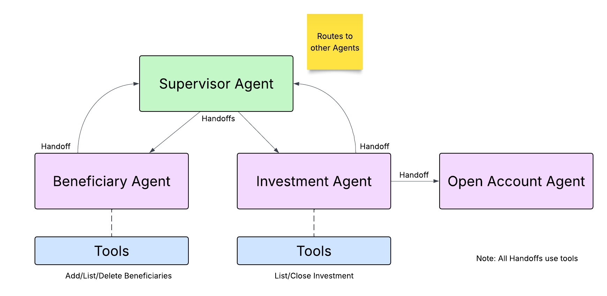

# Wealth Management Agent Example using Vercel AI SDK

A multi-agent wealth-management demo built with the [Vercel AI SDK](https://ai-sdk.dev) and [Temporal](https://temporal.io).

A supervisor agent routes customer requests to specialist sub-agents (beneficiaries, investments, open account). Two versions are included:

- A **non-Temporal CLI** that runs the same agent loop in a single process — useful for iterating on prompts and tools. It opens accounts directly with a simple tool (no KYC, compliance approval or saga).
- A **Temporal-integrated** version where the agent runs inside a Temporal Workflow as a durable, replayable, long-running conversation. A child workflow handles a multi-step "open new investment account" flow with KYC and compliance checkpoints. The child workflow can optionally run in [Java](java/README.md), showing a polyglot (TypeScript + Java) application.

The Temporal version also has a **Chaos Panel** that injects failures at runtime (API and LLM outages, rate limits, a saga rollback, a bug in workflow code) to show how Temporal recovers. See [Failure scenarios](src/temporal_supervisor/README.md#failure-scenarios-chaos-panel).



## Prerequisites

- [Node.js 20+](https://nodejs.org/) and npm
- [Temporal CLI](https://github.com/temporalio/cli) (only required for the Temporal version)
- [Redis](https://redis.io/) (used by the Temporal version for chat history and the chaos panel; optionally for the claim-check payload codec)
- A [Google Gemini API key](https://aistudio.google.com/app/apikey)
- JDK 25 or later — optional, only to run the Open Account workflow in [Java](java/README.md) (the Gradle wrapper is included; no separate Gradle install needed)

## Install dependencies

From the project root:

```bash
npm install
```

The React UX has its own dependencies: run `npm install` in `frontend/` too (see the [frontend README](frontend/README.md)).

## Set up your Gemini API key

Create `setllmkey.sh` at the project root with your key:

```bash
export GOOGLE_GENERATIVE_AI_API_KEY="<your-key-here>"
```

`setllmkey.sh` is gitignored. The Temporal worker start scripts source it; for the CLI, source it yourself (see the [CLI README](src/vai_supervisor/README.md#run)).

Claim check is optional (see the [Temporal README](src/temporal_supervisor/README.md#set-up-claim-check-optional)). If you don't create `setclaimcheck.sh`, the worker, API and codec server start scripts print a harmless `setclaimcheck.sh: No such file or directory` message.

The demo data lives in JSON files in `data/` (tracked by git), which the demo updates as you open and close accounts and edit beneficiaries or client details. Reset it with `git checkout data/` from the project root.

## Getting Started

Pick the version you want to run:

- **[Vercel AI SDK Only CLI](src/vai_supervisor/README.md)** — run the agent using Vercel AI SDK via the command line.
- **[Temporal Version](src/temporal_supervisor/README.md)** — run the durable agent Temporal version
- **[Open Account workflow in Java](java/README.md)** — run the Open Account child workflow in Java alongside the TypeScript supervisor

Also see the [API](api/README.md) and [React UX](frontend/README.md) READMEs.

## Tests

Run each from the project root:

```bash
npm test                            # TypeScript workflow tests
(cd frontend && CI=true npm test)   # React UX tests (after npm install in frontend/)
(cd java && ./gradlew test)         # Java workflow tests (JDK 25)
source setllmkey.sh && npm run test:live   # live agent handoff test (calls the Gemini API)
```

To exercise the Open Account workflow by hand without the chat or the LLM, run `src/temporal_supervisor/startlocalopenaccount.sh` (needs Temporal running; see [Testing the open-account workflow on its own](src/temporal_supervisor/README.md#testing-the-open-account-workflow-on-its-own)).

The TypeScript tests download the Temporal test server on the first run. See [Running the tests](src/temporal_supervisor/README.md#running-the-tests).
