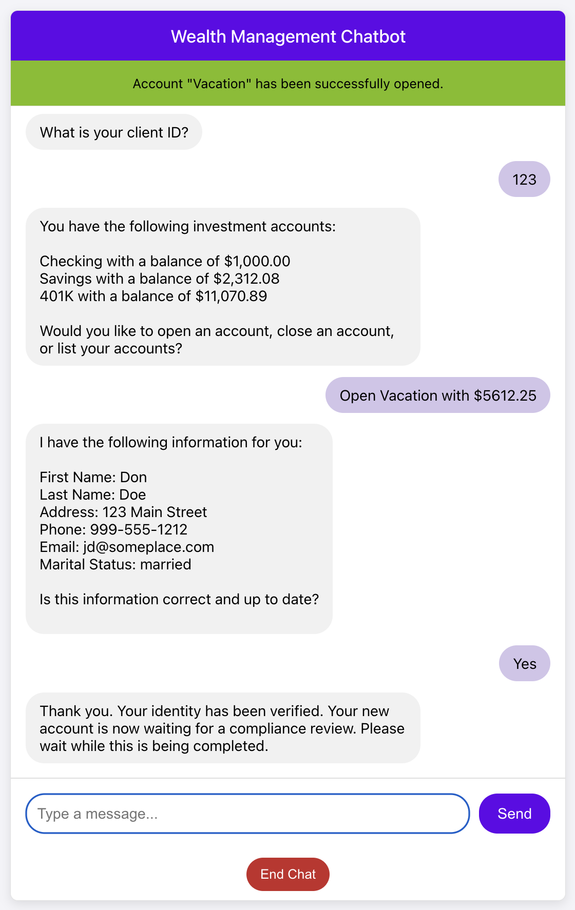

# React Web App for Wealth Management

An easy to use web based front end for the Wealth Management Agent.
It uses the [API](../api/README.md) to interact with Temporal.

## Prerequisites

[Node.js](https://nodejs.org/en/download): Version 20.0.0 or higher, with npm.

The web application relies on the API to communicate with Temporal.
Be sure to follow the instructions to run the API, which can be found [here](../api/README.md),
and the worker, which can be found [here](../src/temporal_supervisor/README.md#running-the-demo-locally).

Note that the web application communicates directly with the API and the API is what
communicates with Temporal running locally or in the cloud.

## Install Dependencies
From the project root:
```bash
cd frontend
npm install
```

## Running the Web App
From the `frontend` directory:
```bash
npm start
```

The app opens at http://localhost:3000. It calls the API at `API_BASE_URL` in
[src/config.js](src/config.js) (default `http://127.0.0.1:8000`). The API's CORS settings allow
`http://localhost:3000` and `http://127.0.0.1:3000`, so if you serve the app from another origin,
update the `cors` origins in [src/api/server.ts](../src/api/server.ts) too.

Each time you click **Start Chat**, the app starts a new chat workflow with a random workflow ID that starts
with `vai-temporal-agent-` (`WORKFLOW_ID_PREFIX` in [src/App.js](src/App.js)), so chats in several browser tabs each get their own workflow.

Click **Chaos** in the header to open the chaos panel, which injects failures to show how Temporal
recovers (see [Failure scenarios](../src/temporal_supervisor/README.md#failure-scenarios-chaos-panel)).
Click **Hide chaos** to close it.

When you open a new investment account, approve the compliance review in another terminal with
either of the commands below. Quote the child workflow ID: it ends with the account name, which can
contain spaces. The UI doesn't show the ID; see
[how to find it](../src/temporal_supervisor/README.md#send-the-compliance-reviewed-signal).

### Send the Compliance Reviewed Signal (Local)
From the project root:
```bash
cd src/temporal_supervisor
./localsendcomplianceapproval.sh "<Child Workflow ID>"
```

### Send the Compliance Reviewed Signal (Cloud)
From the project root:
```bash
cd src/temporal_supervisor
./cloudsendcomplianceapproval.sh "<Child Workflow ID>"
```

## Tests

From the `frontend` directory:

```bash
CI=true npm test
```

Without `CI=true`, `npm test` starts in interactive watch mode.

## Example

Here's an example screenshot of the web application after opening a new account:


