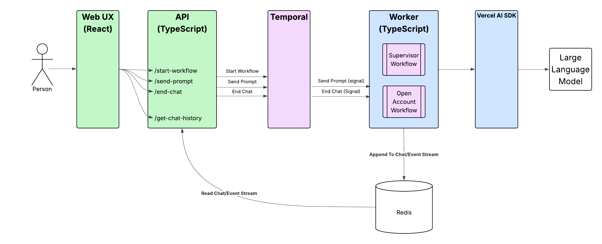
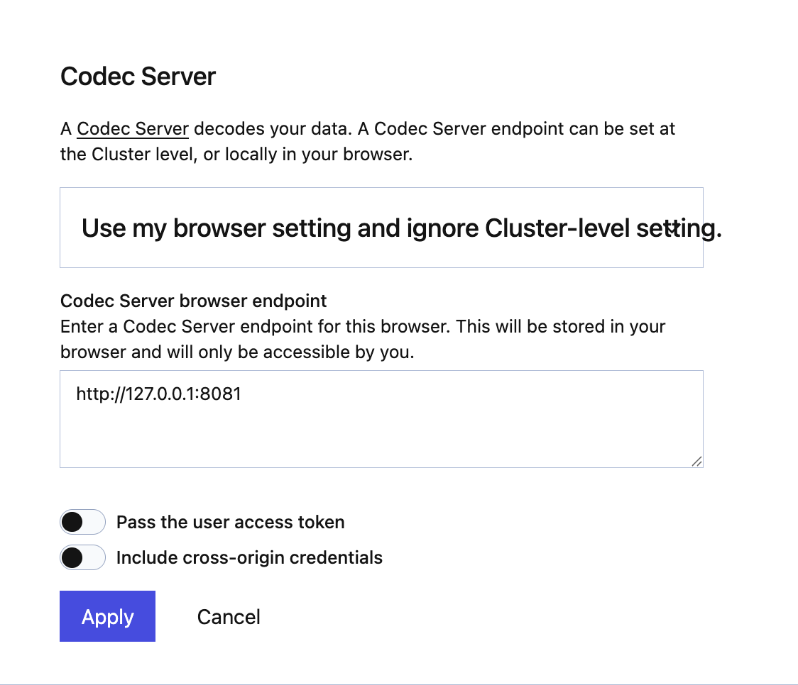
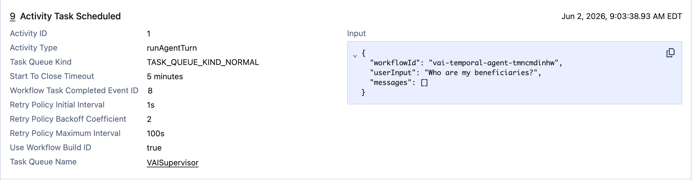
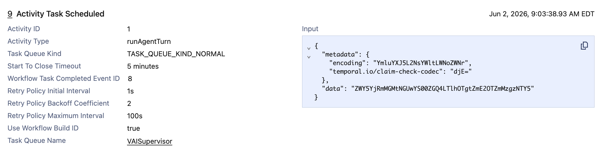
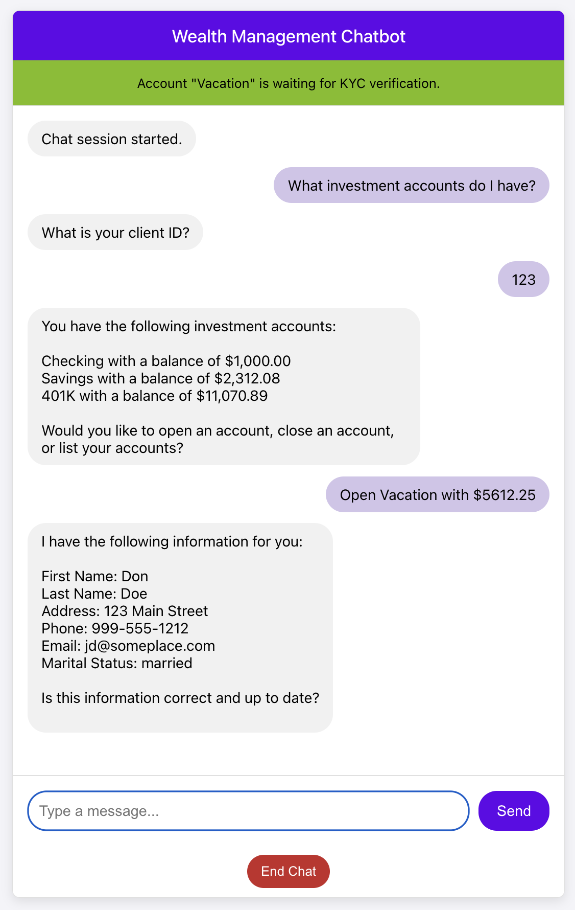
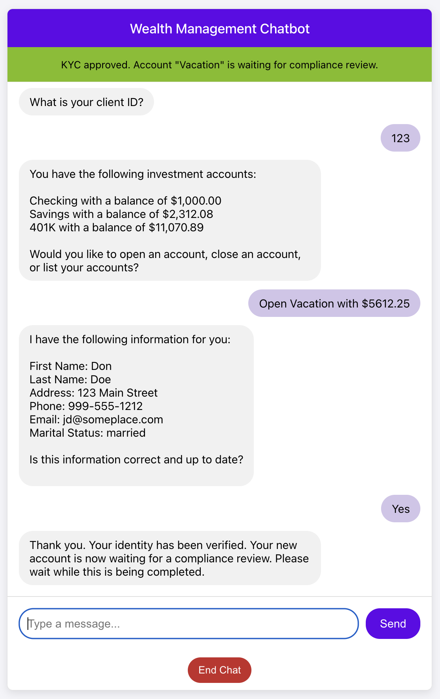
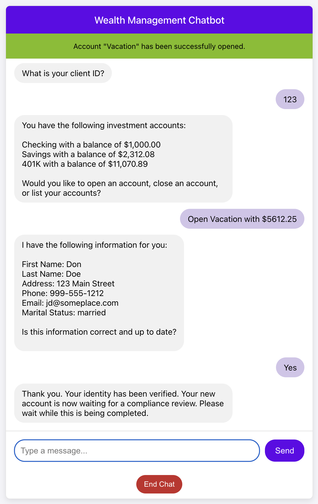
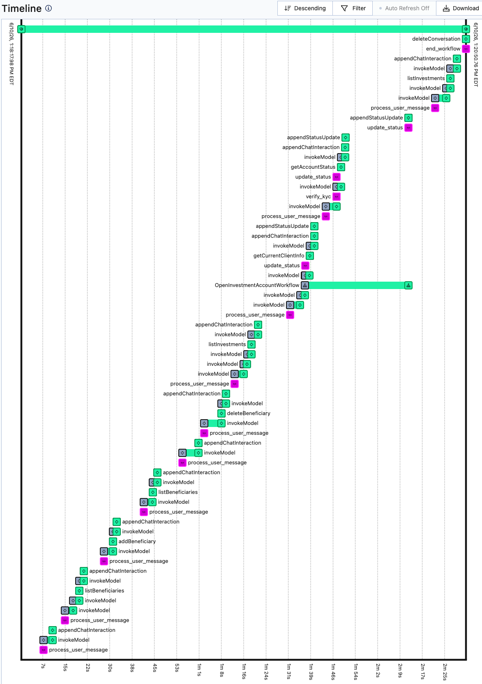
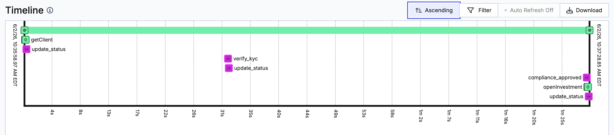

# Wealth Management Agent Example using Vercel AI SDK

Demonstrates how to use [Vercel AI SDK](https://ai-sdk.dev/) with [Temporal](https://temporal.io/).
It runs the agent loop inside a Temporal Workflow as a durable, replayable, long-running conversation,
with each model call and tool call running as an Activity. It uses tools to hand off to other agents.

Scenarios currently implemented include
* Add Beneficiary - add a new beneficiary to your account
* List Beneficiaries - shows a list of beneficiaries and their relationship to the account owner
* Delete Beneficiary - delete a beneficiary from your account
* Open Investment Account - opens a new investment account using a **Child Workflow**, which can optionally
  run in [Java](../../java/README.md). It waits for KYC and compliance approval, and opening is a saga: if a
  step fails, the steps already done are undone. See
  [How the Open Account functionality works](#how-the-open-account-functionality-works).
* List Investments - shows a list of accounts and their current balances
* Close Investment Account - closes an investment account
* Off-topic questions - questions that are not about beneficiaries or investment accounts are politely
  declined by the supervisor agent (this is handled in the agents' prompts)

The Temporal version also has a **Chaos Panel** that injects failures at runtime (API and LLM outages,
rate limits, a saga rollback, a bug in workflow code) to show how Temporal handles them. See
[Failure scenarios](#failure-scenarios-chaos-panel).

## Application Architecture

The overall application architecture looks like this:



There is a React UX which is where the customer interacts with the application.
The React UX leverages an API which exposes endpoints to start a workflow, send a prompt,
retrieve the chat history, end the chat, and set the chaos flags (see the [API README](../../api/README.md)).
The React frontend uses adaptive polling
to retrieve new events from Redis, providing real-time status updates as the Open Account
child workflow progresses through the different steps.

The API in turn, communicates with Temporal to start workflows and send signals. Finally,
the worker contains the two workflows - supervisor and open account - which contain the
agents and business logic that drive the agentic application.

## Prerequisites

- [Node.js 20+](https://nodejs.org/) and npm (for the worker, the API and the React UX)
- [Temporal CLI](https://github.com/temporalio/cli)
- [Redis](https://redis.io/) (used for chat history and the chaos panel; optionally for the claim-check payload codec)
- A [Google Gemini API key](https://aistudio.google.com/app/apikey)
- JDK 25 or later (optional, only to run the Open Account workflow in [Java](../../java/README.md); the Gradle
  wrapper is included, so no separate Gradle install is needed)

## Install dependencies

From the project root:

```shell
npm install
```

## Set up your Gemini API key

Create `setllmkey.sh` at the project root with your key:

```shell
export GOOGLE_GENERATIVE_AI_API_KEY="<your-key-here>"
```

`setllmkey.sh` is gitignored. The worker start scripts (`startlocalworker.sh`, `startcloudworker.sh`) source it.

## Set up Redis

Redis is used for storing conversation history and providing real-time status updates. If you don't have an existing Redis server, you can run one locally after installing it.

In a new terminal / shell run the following command:
```shell
redis-server
```

By default, the application expects to find Redis running locally (`localhost:6379`). You can override the location of Redis by setting the environment variables (the Java worker reads the same ones):

```shell
export REDIS_HOST=localhost
export REDIS_PORT=6379
```

## Set up Claim Check (optional)

An optional configuration is to substitute the data sent to Temporal (e.g. function/method parameters and return values)
with an ID. This is known as the [Claim Check Pattern](https://www.enterpriseintegrationpatterns.com/patterns/messaging/StoreInLibrary.html).
The original data is stored in Redis. This uses a
[Custom Payload Codec](https://docs.temporal.io/develop/typescript/converters-and-encryption)
that intercepts data going to Temporal Cloud, replaces it with a GUID. When the data is retrieved, it looks up the GUID
replaces it with the data stored in Redis.

From the project root:

```shell
cp setclaimcheck.sh.example setclaimcheck.sh
chmod +x setclaimcheck.sh
```

Now edit the setclaimcheck.sh file and fill in the location of Redis
It should look something like this:
```shell
export USE_CLAIM_CHECK=true
export REDIS_HOST=localhost
export REDIS_PORT=6379
```

Save the file and be sure that you have Redis running. For example:

```shell
redis-server
```

Claim check is optional. If you don't create `setclaimcheck.sh`, the worker, API and codec server start scripts
print a harmless `setclaimcheck.sh: No such file or directory` message and run without claim check.

Note that the application assumes you only have one Redis server that is used by the application for storing the
conversation history and is also used if Claim Check has been enabled.

Be aware that using a claim check pattern introduces performance costs by doing remote calls to Redis for every payload.
Also, make sure your Redis implementation is rock solid as any downtime will directly affect your workflows.

## Run Codec Server for Claim Check (optional)
If you have decided to set up the Claim Check above, you will
most likely want to also run a Codec Server to be able to see the actual sent to
the workflow and activities.

Be sure you have updated the setclaimcheck.sh as mentioned above.

To run the Codec Server:
```shell
cd src/temporal_supervisor
./startcodecserver.sh
```

And of course, make sure that your Redis Server is up and running.

Once it's up and running, the default endpoint is http://127.0.0.1:8081 (set `CODEC_SERVER_HOST` and
`CODEC_SERVER_PORT` to change it).

Open up your browser and navigate to the Temporal UI. Locally, open it at exactly http://localhost:8233
(the codec server only allows requests from that origin, so http://127.0.0.1:8233 won't work).
For Temporal Cloud that will be https://cloud.temporal.io

In the upper right, there is an icon that looks like glasses. Click on that and you
can configure your codec server.

Change the drop down to "Use my browser setting and ignore Cluster-level setting".

Use the endpoint of your codec server (default is http://127.0.0.1:8081). Be sure there are no
extra spaces at the end of the URL or it will not work. You can turn off the two options - Pass the
user access token and Include cross-origin credentials. Click on apply and you have configured
the codec server.



As you run through different scenarios, you'll be able to see the decoded values in the browser.



If you remove the codec server settings, you won't be able to see anything other than a BASE64 Encoded ID.



## Running the Demo locally

Run each of these in its own terminal, starting from the project root.

### Start Temporal

```shell
temporal server start-dev
```

### Start the Worker

```shell
cd src/temporal_supervisor
./startlocalworker.sh
```

The worker polls the `VAISupervisor` task queue, and runs the model calls on `VAISupervisor-llm`
(see [Environment variables](#environment-variables)).

### Run the Open Account workflow in Java (optional)

To run the Open Account child workflow in Java instead, pass a task queue name to the worker
and start the [Java worker](../../java/README.md) with the same name. The argument sets
`TEMPORAL_TASK_QUEUE_OPEN_ACCOUNT` (see `setsplitworkflows.sh` in the project root). This works the
same way with `startcloudworker.sh`.

```shell
cd src/temporal_supervisor
./startlocalworker.sh OpenAccount

# in another terminal
cd java
./startlocalworker.sh OpenAccount
```

### Start the API

```shell
cd api
./startlocalapi.sh
```

### Start the UX

```shell
cd frontend
npm install   # first time only
npm start
```

A new browser window opens where you can interact with the application.

### Send the Compliance Reviewed Signal

When you open a new investment account, the workflow waits for a compliance review. To approve it:

```shell
cd src/temporal_supervisor
./localsendcomplianceapproval.sh <Child Workflow ID>
```

The child workflow ID is `OpenAccount-<chat workflow ID>-<client ID>-<account-name-slug>`, where the slug is
the account name lowercased, with each run of other characters replaced by a dash. Each chat in the UX gets a
random workflow ID starting with `vai-temporal-agent-`, so opening "College Fund" for client 123 gives
something like `OpenAccount-vai-temporal-agent-k3j9x2m1q8-123-college-fund`.

The UX doesn't show this ID (it logs the chat's workflow ID in the browser console). To find it, open the [Temporal UI](http://localhost:8233) and look for the
running `OpenInvestmentAccountWorkflow` (it is a child of the chat's `WealthManagementWorkflow`), or use the CLI:

```shell
temporal workflow list --query "WorkflowType='OpenInvestmentAccountWorkflow' AND ExecutionStatus='Running'"
```

Because the ID comes from the chat and the account name, only one opening per account name runs at a time in
a chat: if the agent asks to open the same account again, it continues the opening already in progress. Once
that opening finishes (opened or rolled back), the same name can be opened again.

### Resetting the demo data

Opening and closing accounts, editing client details during KYC and adding or deleting beneficiaries change
the JSON files in `data/` (they are tracked by git). To reset them, from the project root:

```shell
git checkout data/
```

## How the Open Account functionality works

1. The Investment Agent hands off to the Open Account Agent, which calls the `open_new_investment_account`
   tool with the client ID, account name and initial amount. The tool first checks the business rules
   (`validateNewAccount`: a deposit from $100 to $1,000,000, and a name the client doesn't already have).
   If one is broken, the agent explains why and no workflow is started. Otherwise it starts the
   `OpenInvestmentAccountWorkflow` child workflow
   ([workflows/start-open-account.ts](workflows/start-open-account.ts)) on the supervisor's task queue, or on
   `TEMPORAL_TASK_QUEUE_OPEN_ACCOUNT` when the [Java worker](../../java/README.md) runs it, and returns the
   child workflow ID.
2. The child workflow ([workflows/open-account.ts](workflows/open-account.ts)) loads the client's details and
   moves to `Waiting KYC`. Every state change is sent to the chat workflow with the `update_status` signal
   (`{account_name, state, workflow_id}`), which writes `New <account> account status changed: <state>` to
   Redis; the UX shows it in its status area. The agent itself learns the status by calling the
   `get_account_status` tool, which queries `get_current_state` on the child. It only does so while handling a
   customer message, so the customer asks (for example "what's the status?") to get an update in the chat.
3. KYC: the agent calls `get_current_client_info` (the `get_client_details` update, which waits until the
   details are loaded), shows the details, and asks if they are correct. If the customer confirms in a later
   message, `approve_kyc` sends the `verify_kyc` signal. The tool refuses to approve in the same turn the
   details were shown, or with a confirmation given for a different opening. If the details are wrong, the
   agent collects the changes and calls `update_client_details` (an update that saves them to
   `data/clients.json` and also approves KYC).
4. The workflow moves to `Waiting Compliance Review` and waits for the `compliance_approved` signal, which you
   send with `localsendcomplianceapproval.sh` / `cloudsendcomplianceapproval.sh <Child Workflow ID>`.
5. The account is then opened as a saga: create the account record (`openInvestment`), transfer the initial
   deposit from the linked bank account (`debitLinkedAccount`), and register the account with the custodian
   (`registerAccount`). If a step fails non-retryably, the completed steps are undone in reverse order
   (`creditLinkedAccount` refund, then `closeInvestment`) and the final state starts with `Rolled back`. The
   transfer IDs make retried transfers idempotent. On success the state is `Complete`, and the Open Account
   Agent hands back to the Investment Agent.
6. With the **Bug in workflow code** chaos flag on, the opening gets a `WELCOME-BONUS` promo code, and the
   workflow's bonus lookup fails after compliance approval (see
   [Failure scenarios](#failure-scenarios-chaos-panel)).

Ending the chat terminates any opening that is still running, because a child workflow is terminated when its
parent closes.

## Failure scenarios (chaos panel)

Click **Chaos** in the chat header to open the chaos panel. Its switches inject
failures at runtime: activities and the model read the flags from Redis on every
attempt, so you can turn a failure on and off mid-conversation without restarting
anything. The panel also lists each injected failure as it happens (activity and
attempt number). Open the [Temporal UI](http://localhost:8233) alongside it to show
the pending activity, its attempt count, and the last failure. **Reset all** turns
every flag off and clears the failure log.

| Scenario | How to show it | What Temporal does |
|---|---|---|
| Tool / API down | Turn on **Core banking API down**, ask to list your investments, wait, turn it off | The investment and beneficiary activities fail with a connection error and are retried (at most 5 seconds apart) until the switch is off. The agent waits mid-turn; nothing is lost or re-asked. |
| LLM down | Turn on **Gemini API down** and send a message | The model call is an activity, so it is retried the same way (at most 10 seconds apart) and the conversation resumes where it was. |
| LLM rate limited | Turn on **Gemini rate limited (429)** and send a message | The model activity fails with `nextRetryDelay: 15s`, which overrides the backoff like a Retry-After header: attempts are exactly 15 seconds apart. A real 429 from Gemini is handled the same way. |
| Proactive rate limit | Restart the worker with `LLM_MAX_CALLS_PER_SECOND=0.2 ./startlocalworker.sh` and chat in several tabs | Model calls run on their own task queue (`TEMPORAL_TASK_QUEUE_LLM`, default `VAISupervisor-llm`), which the Temporal server rate limits across all workers. Calls queue up instead of failing. |
| Business rule | Ask to open an account with $2,000,000 (over the $1,000,000 limit), under $100, or with the name of an account you already have | Validation fails once, non-retryably, and the agent explains why. No account opening is started. |
| Saga rollback | Turn on **Custodian rejects new accounts** (and **Slow account-opening steps**), then open an account through compliance approval. Without flags: as client 123, open an account with $300,000 (the linked bank account has $250,000) | Opening an account creates the account record, debits the linked bank account, then registers with the custodian. A non-retryable failure undoes the completed steps in reverse: refund, then remove the account. Transfers are idempotent, so a retried debit or refund never moves money twice. With slow steps on, you can kill the worker mid-rollback and it picks up where it left off. |
| Bug in workflow code | Turn on **Bug in workflow code** and open an account through compliance approval | New openings get a `WELCOME-BONUS` promo code, and the workflow's promo code path has a real bug. The workflow *task* fails with a `TypeError` (`NullPointerException` in Java), and the workflow stays Running with all its state while other chats keep working. |

To fix the workflow bug, swap the two `PROMOTIONS` lines in
[workflows/open-account.ts](workflows/open-account.ts) (or the two `BONUS_RATES` lines in the
[Java workflow](../../java/src/main/java/io/temporal/demo/wealthmanagement/workflow/OpenInvestmentAccountWorkflowImpl.java))
and restart the worker. Turning the switch off doesn't help, because the promo code is part of the
workflow's input. Workflow task retries back off (to as much as 10 minutes), so after a fix it can take
from a few seconds to a minute or so for the workflow to resume. Afterwards, `git checkout` the file to
re-arm the bug.

A few things to know:

* The flags live in Redis (`chaos:flags`), so every worker using that Redis sees them. To test without
  disturbing someone else's demo, use a different Redis or Temporal server.
* The linked bank balances and the transfer ledger are in `data/funding-accounts.json`, and the demo
  updates them (and `data/investments.json`) as accounts are opened and rolled back.
* Retries are unlimited, so a bad Gemini API key stalls a turn instead of failing it. Check the
  pending activity in the Temporal UI.
* If you change which activities or child workflows a workflow runs, end the chats started on the old
  code; they would fail on replay. The workflow-bug fix above is safe because it doesn't change the steps.
* Each chat runs in a single workflow run. A production system would need continue-as-new for long
  conversations (see the TODO in [workflows/wealth-management.ts](workflows/wealth-management.ts)).

## Environment variables

The worker, API and scripts read these (see `src/common/client-helper.ts` and `src/common/redis-config.ts`):

| Variable | Default | Purpose |
|---|---|---|
| `GOOGLE_GENERATIVE_AI_API_KEY` | none | Gemini API key (set in `setllmkey.sh`) |
| `TEMPORAL_ADDRESS` | `localhost:7233` | Temporal frontend address |
| `TEMPORAL_NAMESPACE` | `default` | Namespace |
| `TEMPORAL_API_KEY` | empty | API key auth for Temporal Cloud |
| `TEMPORAL_TLS_CLIENT_CERT_PATH`, `TEMPORAL_TLS_CLIENT_KEY_PATH` | empty | mTLS auth for Temporal Cloud |
| `TEMPORAL_TASK_QUEUE` | `VAISupervisor` | Task queue for the supervisor workflow, the activities and (by default) the Open Account workflow |
| `TEMPORAL_TASK_QUEUE_OPEN_ACCOUNT` | unset | Task queue for the Open Account workflow (the Java worker). Set by the worker start scripts' optional argument |
| `TEMPORAL_TASK_QUEUE_LLM` | `<TEMPORAL_TASK_QUEUE>-llm`, i.e. `VAISupervisor-llm` | Task queue for the model calls |
| `LLM_MAX_CALLS_PER_SECOND` | unset (no limit) | Server-side rate limit for the model calls task queue, e.g. `LLM_MAX_CALLS_PER_SECOND=0.2 ./startlocalworker.sh` |
| `REDIS_HOST`, `REDIS_PORT` | `localhost`, `6379` | Redis for chat history, chaos flags and claim check |
| `USE_CLAIM_CHECK` | `false` | `true` turns on the claim-check codec (set in `setclaimcheck.sh`) |
| `CODEC_SERVER_HOST`, `CODEC_SERVER_PORT` | `127.0.0.1`, `8081` | Codec server bind address |

The API has its own settings (`API_HOST`, `API_PORT`); see the [API README](../../api/README.md).

### Running the tests

From the project root:

```shell
npm test
```

The tests run the workflows against a local Temporal test server, which is downloaded automatically on the
first run, with stub activities and a scripted model (no Redis, Gemini key or worker needed). They cover the
saga (happy path, rollback in reverse order, undoing only completed steps, transient retries), the promo-code
bug pausing the workflow, starting only one opening per account, the KYC approval check, the business rules,
idempotent transfers, the 429 handling, and the agent instructions (off-topic handling).

The other test suites:

```shell
# React UX (run once; without CI=true it starts in watch mode)
cd frontend
npm install   # first time only
CI=true npm test

# Java Open Account workflow (from the project root)
cd java
./gradlew test
```

#### Live agent handoff test

`npm test` uses a scripted model, so it can't check what the model decides to do. The live test runs the real
chat workflow against Gemini: the customer asks about beneficiaries, gives client ID 123, then asks what
investments they have. The Beneficiary Agent must hand the conversation to the Investment Agent (through the
supervisor) in the same turn, without asking the customer whether to transfer or announcing the transfer, and
the reply must list the investment accounts. It calls the paid Gemini API, so it isn't part of `npm test`:

```shell
source setllmkey.sh
npm run test:live
LIVE_TEST_RUNS=10 npm run test:live   # repeat the conversation, since model output varies
```

Redis is optional for this test (without it, the chaos flags read as off).

## Running the demo in Temporal Cloud

Copy setcloudenv.example from the src/temporal_supervisor folder to the project root as setcloudenv.sh.
From the project root:

```shell
cp src/temporal_supervisor/setcloudenv.example setcloudenv.sh
```

Edit setcloudenv.sh to match your Temporal Cloud account:

```shell
export TEMPORAL_ADDRESS=<namespace>.<accountID>.tmprl.cloud:7233
export TEMPORAL_NAMESPACE=<namespace>.<accountID>
export TEMPORAL_TLS_CLIENT_CERT_PATH="/path/to/cert.pem"
export TEMPORAL_TLS_CLIENT_KEY_PATH="/path/to/key.key"
```

To use an API key instead of certificates, replace the two certificate lines with
`export TEMPORAL_API_KEY=<your-api-key>`. `setcloudenv.sh` is gitignored; keep keys and certificates
out of the repository.

### Start the Worker

```shell
cd src/temporal_supervisor
./startcloudworker.sh
```

To run the Open Account workflow in Java, use `./startcloudworker.sh OpenAccount` here and in `java/`
(see [Run the Open Account workflow in Java](#run-the-open-account-workflow-in-java-optional)).

### Start the API

```shell
cd api
./startcloudapi.sh
```

### Start the UX

```shell
cd frontend
npm install   # first time only
npm start
```

### Send the Compliance Reviewed Signal

When you open a new investment account, approve the compliance review with the script below. It reads the
connection settings from `setcloudenv.sh` in the project root. Find the child workflow ID in the Temporal
Cloud UI as described in [Send the Compliance Reviewed Signal](#send-the-compliance-reviewed-signal).

```shell
cd src/temporal_supervisor
./cloudsendcomplianceapproval.sh <Child Workflow ID>
```

Here are a few screenshots of the UX while opening a new account.

Waiting for KYC to be confirmed:


Waiting for the Compliance Review to be done:


New account is complete and opened:


You can also add and delete beneficiaries.

Here is a sample event history shown in the Temporal UX



And here is a sample event history for the Open Account workflow in the Temporal UX:

